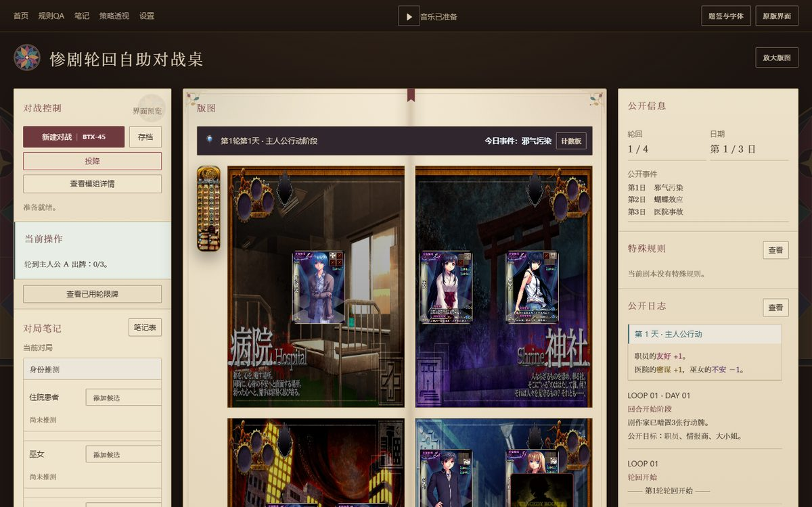
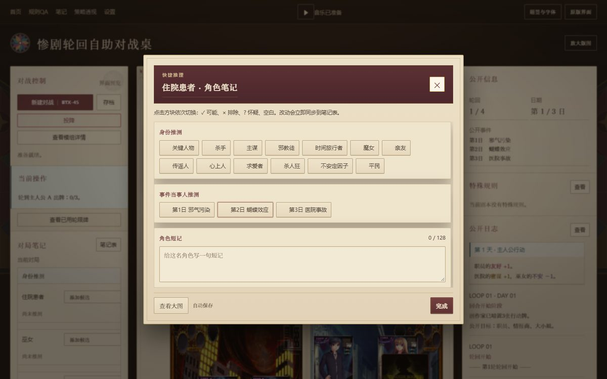
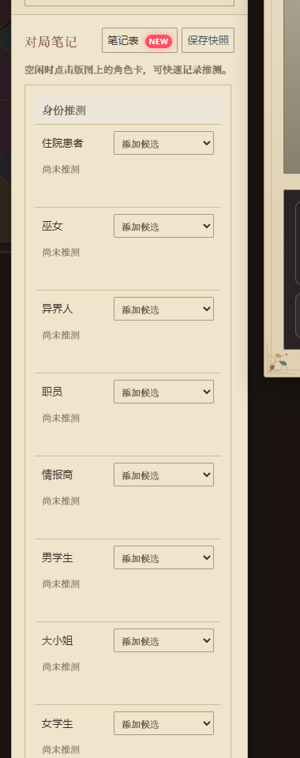
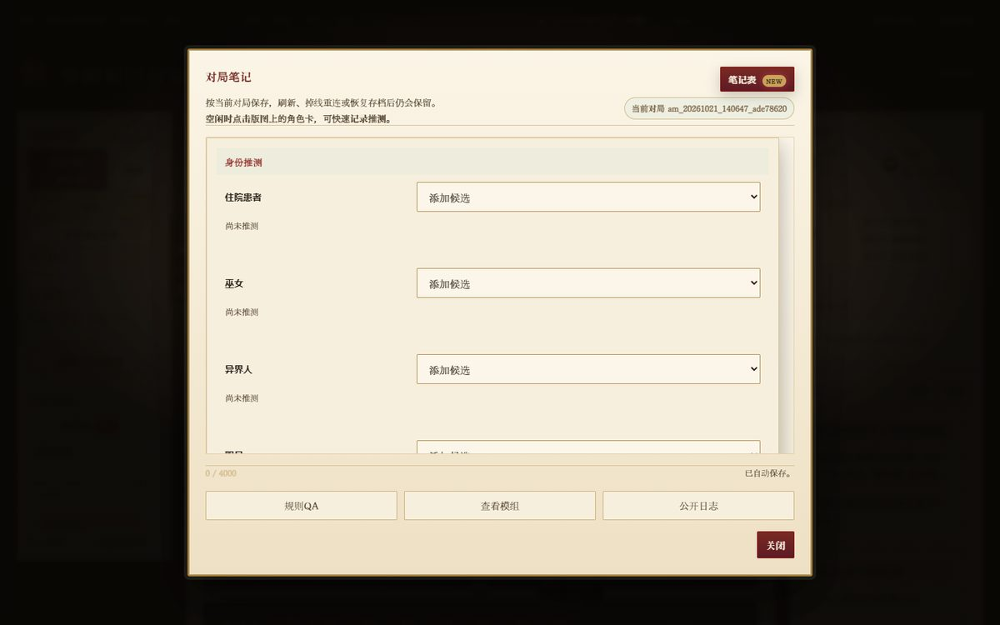
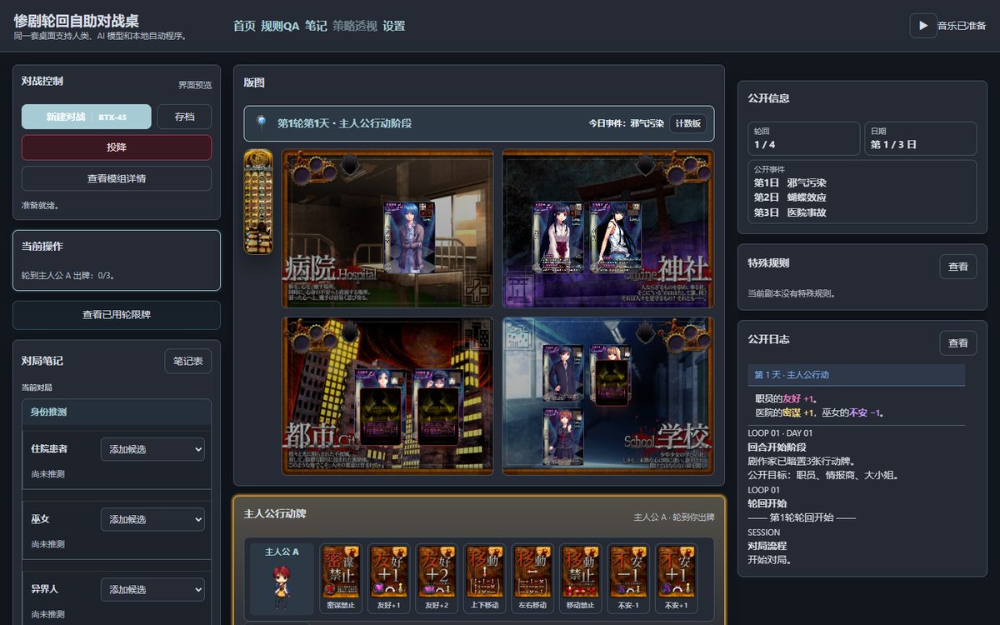
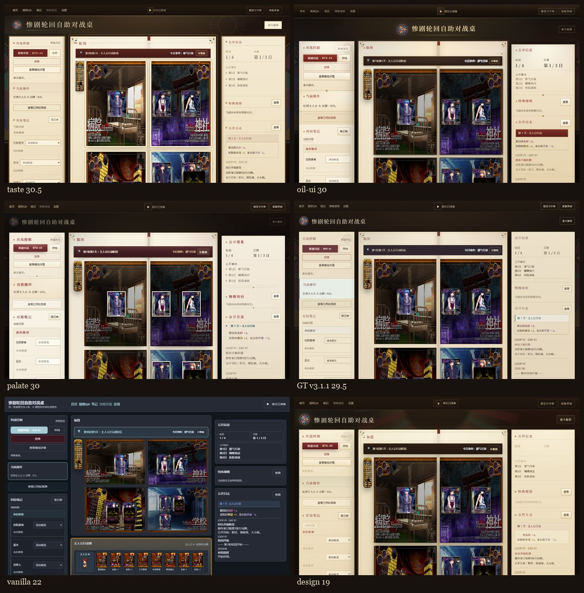

# Tragedylooper Extension Pack

《惨剧轮回》在线对战桌的**纯前端视觉扩展**：把原本深色 dashboard 风格的自动对战界面，重做成"烛光下的泥金抄本 / 石造教堂彩窗"的方向。

- **只改表现层**：不触碰原站 DOM 结构、事件绑定、拖拽、快捷键与任何 API 调用；角色卡点击、笔记、快捷推理、拖放出牌全部仍由原站逻辑驱动。
- **不打包游戏素材**：版图、角色卡、行动牌、音效都从原站按原 URL 加载。
- 当前版本：**v3.2.2**（Chrome MV3 扩展 + 等价的用户脚本）。

## 预览

**书卷版图**——皮封边、鎏金页边、书脊折缝，版图角色卡与行动牌仍在原来的位置与尺寸：



**角色卡快捷推理**——点版图上的角色卡打开；背景只轻压暗，棋盘保持可见：



**对局笔记（v3.2.1 排版修复）**——标题与工具同排、引导文案暖灰、推理行自然展开：



**对局笔记**——角色推理、事件当事人、自由笔记与快照，同一套羊皮纸/金线语言：



对比原站原生外观（无插件）：



---

---

## 安装

### 方式一：Chrome 扩展（推荐）

1. 打开 `chrome://extensions/`，右上角开启 **开发者模式**；
2. 点 **加载已解压的扩展程序**，选择本仓库的 `extension/` 目录（或解压 `zips/gt-extension-v3.2.2.zip` 后选择解压目录）；
3. 打开 <https://tragic-aiplay.cn/auto_play.html> 即可看到书卷皮肤；
4. 升级后回到扩展页点一次 **Reload**，再刷新游戏页。

### 方式二：用户脚本

安装 Tampermonkey 后，导入 `userscript/stained-glass.user.js`（或 `zips/gt-userscript-v3.2.2.zip`）。脚本内容与扩展 CSS 完全一致，只注入样式。

---

## 仓库结构

```
extension/            Chrome MV3 扩展（manifest + interface.css + interface.js）
userscript/           Tampermonkey 用户脚本（同款 CSS 内联）
reports/              六组设计对比报告（report2.html + 截图）
runs2/                对比中各方向的 mod.css / 说明 / 截图（taste / oil-ui / palate / design）
docs/                 任务简报（BRIEF2）与 GT 交付说明（HANDOFF）
zips/                 上述内容的打包 zip
```

## 覆盖的界面

- 对开书卷布局：皮封边、鎏金页边、书脊折缝、页缘叠层、书签丝带
- 顶部工具栏、左右侧栏（对战控制 / 当前操作 / 对局笔记 / 公开信息 / 特殊规则 / 公开日志）
- 版图角色卡、行动牌手牌区、计数板、阶段卷带
- 全部弹窗：**快捷推理 / 角色笔记**、**对局笔记**、**已用轮限牌**、规则 QA、模组详情、设置、公开日志、快照、角色池、移除区
- 字体规则：Tsukushi 只用于 ≥13px，小字走哥特；正文对比度按 WCAG AA 校正
- 打开角色卡时背景只轻压暗，棋盘保持可见

## 版本

| 版本 | 内容 |
|---|---|
| 2.2.0 | 对开书卷基础壳、可编辑标题、侧栏与版图重绘 |
| 3.0.0 | 合入可读性、交互层、快捷推理、笔记/轮限牌弹窗、版图比例与侧栏宽度 |
| 3.1.0 | 烛光羊皮纸配色：暖棕底、降饱和金/朱红、低反差描边 |
| 3.1.1 | 打开角色卡时遮罩减淡（只压暗，不黑屏）；角色卡大图同规则 |`n| 3.2.0 | 侧栏「对局笔记」重排：标题独占一行，笔记表/保存快照收成右侧工具；引导文案改暖灰 |`n| 3.2.1 | 笔记面板自然展开，去掉面板内裁切与内滚动条；标题与工具尽量同排 |
| 3.2.2 | 左右侧栏不再有内滚动：面板拉长、交给页面滚动；公开日志/特殊规则也一并展开 |

## 六组设计对比（v2）

同一份独立页面、只允许覆盖 CSS、1440×900，按"视觉完成度 / 书卷身份 / 一致性 / 可读性 / 功能保留"五维各 7 分。



| 方案 | 分数 | 特点 |
|---|---|---|
| taste | 30.5 | 皮革封边 + 页缘叠层；版图做成裱在纸上的彩窗图版 |
| oil-ui | 30 | 居中扉页 + 玫瑰窗饰；有限色位（纸 3 / 墨 2 / 金 3 / 朱红 2） |
| palate | 30 | 泥金抄本 + 讲坛卷带；feTurbulence 纸纤维 |
| GT v3.1.1 | 29.5 | 现有版本：烛光暖棕 + 陈酒红/旧金 |
| vanilla | 22 | 原站原生外观（基线）：可用、无身份，存在 1.73:1 对比度问题 |
| design | 19 | 半成品：右栏文字几乎不可见 |

完整报告：`reports/report2.html`（含各组截图与设计说明）。

## 设计原则

1. **一个方向执行到底**：暖中性阶（墨 → 纸 → 金）+ 一个强调色（陈酒红），彩窗宝石色只做环境光与语义；
2. **材料先于装饰**：纸纹、皮革、金线、书脊折缝都来自同一个"书"的物理逻辑，不做玻璃拟态；
3. **层次靠排版**：字号收敛到 6 档，章节标题统一 rubric 体例，正文行高 1.75–1.9；
4. **可读性优先**：所有正文 ≥13px，对比度按 AA 校正；动效可用 `prefers-reduced-motion` 关闭。

## 说明

- 本项目仅为界面外观修改，与原游戏/站点无隶属关系；游戏美术与文本版权归原权利人所有。
- 扩展不修改、不重发任何游戏逻辑请求；如遇站点改版导致选择器失配，按页面实际 class 调整 `interface.css` 即可。
